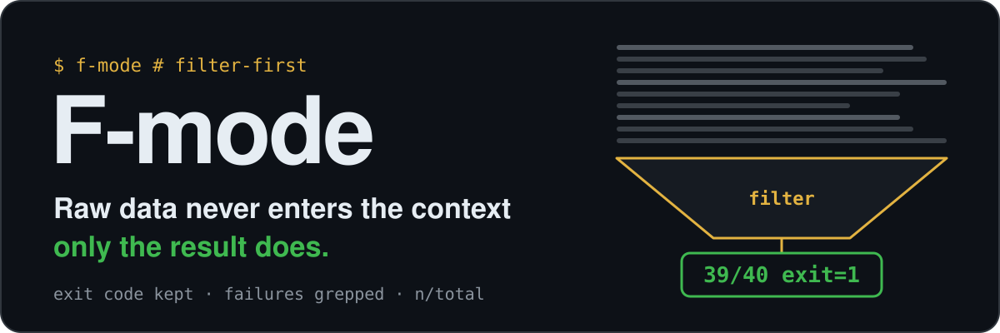
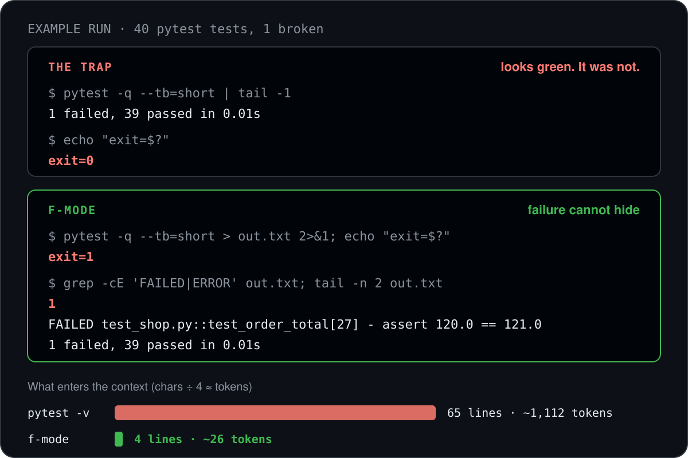

<p align="center">
  
</p>

<p align="center"><b>Filter-first mode for Claude Code and other coding agents.</b><br>The agent filters, counts and summarizes before it reads, so test logs, JSON and SQL dumps stop filling your context. And a filter never hides a failure.</p>

## See it on a failing test run

Same 40 tests, one broken. The common shortcut `| tail` shows a clean last line and `exit=0`. The f-mode pattern keeps the exit code, counts the failure markers and shows the failing test.

<p align="center">
  
</p>

```bash
pytest -q --tb=short > out.txt 2>&1; echo "exit=$?"
grep -cE 'FAILED|ERROR' out.txt; tail -n 2 out.txt
```

<sub>Example run, not a benchmark: a 9-line pytest file with 40 parametrized tests, one made to fail. `pytest -v` printed 65 lines / 4,450 characters; the f-mode pattern printed 4 lines / 104 characters (tokens estimated as characters ÷ 4). Real suites and logs are much larger, so the gap grows with them.</sub>

## What it is

A tiny always-on rule plus a full skill. The rule is injected at session start; the skill holds the details and examples and loads on demand.

| Part | What it does |
|---|---|
| [`hooks/rule.md`](hooks/rule.md) | 14 lines, injected by a `SessionStart` hook in every session. |
| [`skills/f-mode/SKILL.md`](skills/f-mode/SKILL.md) | Full rule with examples: tests, logs, JSON, SQL, browser checks, subagents, secrets, stop rule. |

## Why it works

1. **Move the logic to the data.** A shell pipeline, a script or a subagent does the work. Only a compact summary comes back.
2. **Filtering never hides failure.** `| tail` alone swallows the exit code, so the agent keeps it (`; echo "exit=$?"` or `set -o pipefail`), greps failure markers, and prints counts with denominators such as `39/40`.
3. **Summaries are checked for meaning.** Totals must add up, a known row must be present.

## The rules

1. Filter and aggregate before reading: `grep -c`, `jq`, `GROUP BY`, `uniq -c`.
2. Keep the exit code, grep `FAIL|ERROR|Traceback`, print `passed/total`.
3. Many similar checks: one script, one compact table.
4. Check a summary against a sanity total or a known row.
5. Tests in quiet mode with short tracebacks (`pytest -q --tb=short`, `vitest --reporter=dot`).
6. Browser checks return compact JSON, not DOM dumps.
7. Wide investigation goes to a subagent that returns `file:line` conclusions. Verify them.
8. No secrets or real PII in output: mask or count.
9. Grep before read. Code you will edit is read fully.
10. Same fix failed twice: stop and find the root cause.

```sql
-- instead of SELECT * FROM orders
SELECT status, count(*) FROM orders GROUP BY 1;
```

## Install

**Claude Code plugin (recommended)**

```
/plugin marketplace add komilovsg/f-mode
/plugin install f-mode@f-mode
```

Restart the session.

**Skill only (no always-on hook)**

```bash
git clone https://github.com/komilovsg/f-mode
cp -r f-mode/skills/f-mode ~/.claude/skills/
```

**Other agents (Codex, Cursor, Gemini CLI, ...)**

`skills/f-mode/SKILL.md` follows the open Agent Skills format. To make it always on, paste `hooks/rule.md` into your `AGENTS.md` or rules file.

## Cost and requirements

The always-on part is the 14-line `hooks/rule.md`, about 300 tokens per session. The hook needs `cat` in its shell (macOS, Linux, Git Bash on Windows).

## Turn it off

Say "stop f-mode" to switch it off for the current session, or run `/plugin disable f-mode`.

## License

[MIT](LICENSE)
